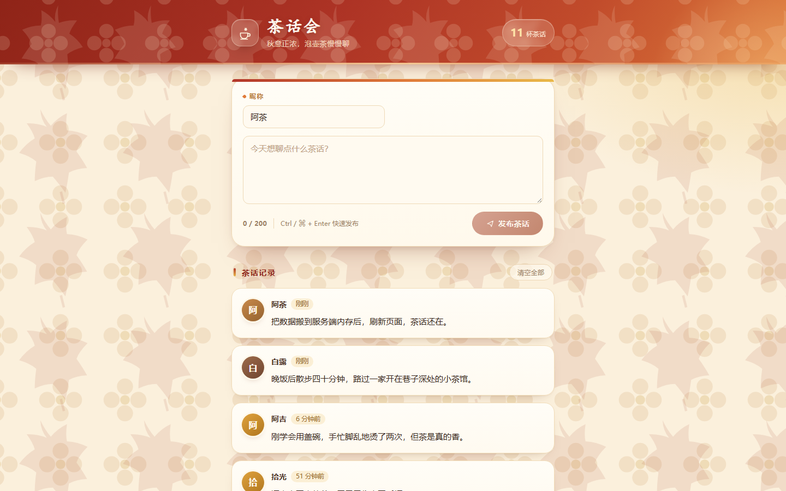
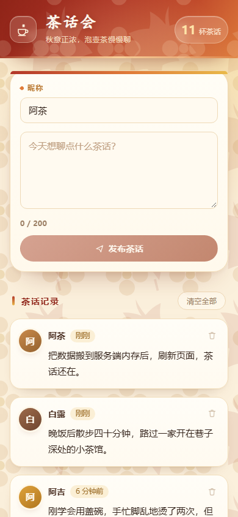

# 茶话会

一个极简的茶话留言板，前端 **Vue 3 + Pinia**，后端 **Hono + 内存存储**，通过 **RESTful API** 通信。项目以 **TDD（测试驱动开发）** 的方式编写：先写失败的测试，再实现到测试通过。

## 界面预览

<p align="center">
  
</p>

<p align="center">
  
</p>

## 视觉风格

暖秋主题：枫叶红与柿子橙渐变品牌栏、奶油黄纸感卡片、金桂色时间标签，页面底色铺满低透明度的桂花与枫叶剪影纹样（内联 SVG，无外部图片与字体）。所有颜色、圆角、阴影与纹样集中定义在 `src/styles/main.css` 的 `:root` 变量中，支持 `prefers-reduced-motion` 动效降级。

## 功能

- 发布茶话：正文最多 200 字，可填昵称（最多 20 字，不填则显示“茶友”）
- 查看茶话：按时间倒序展示，相对时间（刚刚 / x 分钟前 / x 小时前 / x 天前 / 日期）
- 服务端持久：数据保存在 Node 进程内存中，刷新、重开浏览器后依然存在；重启服务则重置
- 字数计数、内容为空时禁止发布、`Ctrl / ⌘ + Enter` 快捷发布
- 单条删除（二次确认）、一键清空全部
- 昵称自动记忆（存服务端 profile）、头像按昵称生成暖秋配色、移动端响应式布局
- 服务启动时自动注入 10 条示例茶话，开箱即有内容；清空后不会回填

## 技术栈

| 层面 | 选型 |
| --- | --- |
| 运行时 | Node.js ≥ 20.19（推荐 22 / 24 LTS） |
| 后端 | Hono 4 + `@hono/node-server`，进程内内存存储 |
| 接口风格 | RESTful JSON，统一 `/api` 前缀 |
| 前端框架 | Vue 3（Composition API + `<script setup>`） |
| 状态管理 | Pinia（options store 写法，actions 全部为异步 API 调用） |
| 构建 | Vite 7（`/api` 代理到 8787） |
| 测试 | Vitest + @vue/test-utils + jsdom；测试用 `app.request` 做 fetch shim，无端口、无网络 |

## 快速开始

```bash
npm install
npm run dev      # 同时启动 API（8787）与前端（5173）
npm test         # 运行全部单元 / 组件 / 接口测试
npm run build    # 生产构建，产物在 dist/
npm run preview  # 预览生产构建（沿用 /api 代理）
npm start        # 仅启动 API 服务
```

`npm run dev` 由 concurrently 同时拉起 `npm run dev:api`（`node --watch server/index.js`）与 `npm run dev:web`（Vite）。前端所有请求走 `/api`，由 Vite 代理到 `http://127.0.0.1:8787`。

## RESTful API

| 方法 | 路径 | 说明 | 成功响应 |
| --- | --- | --- | --- |
| GET | `/api/health` | 健康检查 | `200 { "status": "ok" }` |
| GET | `/api/messages` | 全部茶话，按 `createdAt` 倒序 | `200 { "messages": Message[] }` |
| POST | `/api/messages` | 发布，body `{ content, nickname }` | `201 { "message": Message }` |
| DELETE | `/api/messages/:id` | 删除单条 | `200 { "deleted": true, "id": "..." }` |
| DELETE | `/api/messages` | 清空全部 | `200 { "deleted": 10 }` |
| GET | `/api/profile` | 读取上次使用的昵称 | `200 { "nickname": "阿茶" }` |
| PUT | `/api/profile` | 保存昵称，body `{ nickname }` | `200 { "nickname": "阿茶" }` |

`Message` 字段：`id`、`nickname`、`content`、`createdAt`（毫秒时间戳）。

错误统一为 `{ "error": { "code": "...", "message": "中文提示" } }`：

| 状态码 | code | 场景 |
| --- | --- | --- |
| 400 | `INVALID_CONTENT` | 正文去空白后为空 |
| 400 | `INVALID_JSON` | 请求体不是合法 JSON |
| 404 | `NOT_FOUND` | 消息不存在 / 路由不存在 |
| 500 | `INTERNAL_ERROR` | 未捕获异常 |

## 测试驱动开发

项目遵循红 → 绿 → 重构的节奏：

1. **红**：先写 `*.spec.js` 描述期望行为（REST 契约、store 的异步数据流、组件交互、App 集成），运行 `npm test` 确认失败。
2. **绿**：再实现 `server/*`、`src/api/client.js`、`src/stores/messages.js` 与组件，直到全部测试通过。
3. **重构**：在测试保护下拆分模块，保持行为不变。

当前覆盖 10 个测试文件、95 个用例：

| 测试文件 | 关注点 |
| --- | --- |
| `server/store.spec.js` | 内存存储：示例注入、排序、增删清空、昵称、边界截断、副本隔离 |
| `server/app.spec.js` | REST 契约：状态码、响应体、错误码、profile 同步、未匹配路由 |
| `src/api/client.spec.js` | 请求前缀/方法/请求体、JSON 解析、400/404 归一、网络异常兜底 |
| `src/stores/messages.spec.js` | hydrate 载入、发布/删除/清空的服务端同步、失败降级、昵称记忆 |
| `src/components/MessageComposer.spec.js` | 计数、按钮禁用、trim 提交、空内容拦截、Ctrl+Enter、输入上限 |
| `src/components/MessageItem.spec.js` | 渲染、头像、HTML 转义、换行保留、删除事件 |
| `src/components/MessageList.spec.js` | 列表渲染、空状态、事件透传 |
| `src/utils/time.spec.js` | 相对时间边界（刚刚 / 分钟 / 小时 / 天 / 日期 / 跨年 / 非法值） |
| `src/utils/avatar.spec.js` | 头像渐变确定性、首字兜底 |
| `src/App.spec.js` | 集成：首屏载入、发布、删除、清空、刷新后从服务端读回、后端不可用降级 |

测试中不监听端口：`tests/setup.js` 为每个用例创建独立的内存 store 与 Hono 实例，并把 `globalThis.fetch` 指向 `app.request`，前端代码因此跑的是真实路由与序列化。

```bash
npm run test:watch   # 监听模式，TDD 时使用
```

## 目录结构

```
.
├── index.html                  # Vite 入口 HTML
├── vite.config.js              # Vite + Vitest 配置（/api 代理、jsdom、setupFiles、别名）
├── package.json
├── server/
│   ├── store.js                # 内存存储：seed、增删清空、昵称 profile
│   ├── app.js                  # Hono 应用与全部 REST 路由
│   ├── index.js                # @hono/node-server 启动（默认 8787）
│   ├── store.spec.js
│   └── app.spec.js
├── src/
│   ├── main.js                 # 创建应用、注册 Pinia、引入全局样式
│   ├── App.vue                 # 页面装配：品牌栏 + 发布卡片 + 消息流 + 页脚
│   ├── App.spec.js
│   ├── api/
│   │   ├── client.js           # fetch 封装 + ApiError，前端数据层唯一出口
│   │   └── client.spec.js
│   ├── components/
│   │   ├── BrandHeader.vue     # 品牌栏与统计
│   │   ├── MessageComposer.vue # 发布表单（校验、计数、快捷发布）
│   │   ├── MessageList.vue     # 消息列表 / 空状态切换
│   │   ├── MessageItem.vue     # 单条茶话卡片
│   │   ├── EmptyState.vue
│   │   └── *.spec.js
│   ├── stores/
│   │   ├── messages.js         # Pinia store：异步 load/add/remove/clear/nickname
│   │   └── messages.spec.js
│   ├── utils/                  # 相对时间格式化、头像渐变
│   ├── data/seed.js            # 示例茶话的昵称池、文案池与生成器（服务端复用）
│   ├── shared/constants.js     # 前后端共享上限与默认昵称
│   └── styles/main.css         # 暖秋主题、纹样、响应式
├── tests/setup.js              # 每个用例重建内存后端 + fetch shim + mock confirm
└── docs/                       # README 使用的界面截图
```

## 数据存储

存储是**进程内内存**（`server/store.js` 中的 `createMemoryStore()`），不使用数据库，不写浏览器 Local Storage：

- 服务启动时若列表为空，注入 10 条示例茶话（时间从「刚刚」铺到 5～6 天前），只注入一次
- 清空全部后再刷新不会回填示例
- 重启 API 进程（`npm run dev` 重启、改代码触发 `node --watch` 重启）会重新注入示例，历史数据丢失
- 需要换一组示例：重启服务即可

## 说明

项目最初是纯 HTML/CSS/JavaScript 版本，后按 TDD 改写为 Vue 3 + Pinia + Local Storage 版本；随后在保持测试驱动的前提下，把数据层替换为 Hono + 内存存储的 REST 服务。原生实现保留在 Git 历史中，可用 `git log` 查看。
